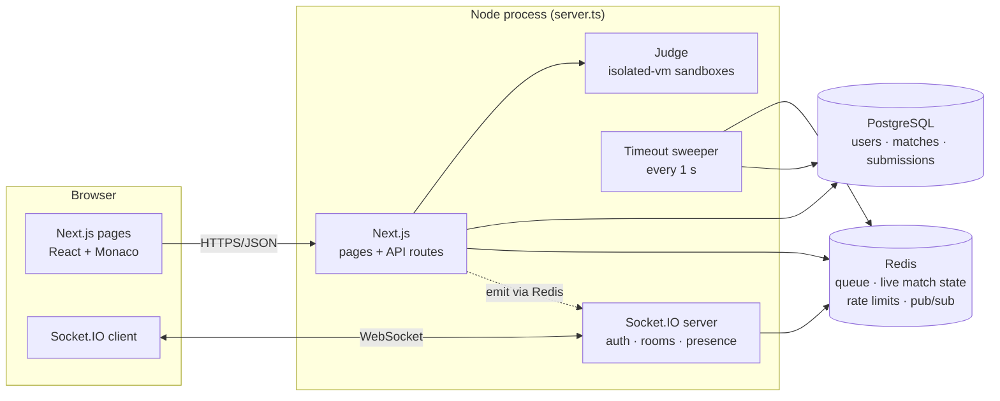

# Code Fighter Z

Real-time 1v1 coding duels. Two players are matched by rating, get the same algorithm problem and the same clock, and the first to pass every hidden test wins. Wins and losses move an Elo rating on a public leaderboard.

**Stack:** Next.js 16 (App Router) · React 19 · TypeScript · Socket.IO · PostgreSQL + Drizzle ORM · Redis · isolated-vm · Zod · Vitest · Docker · GitHub Actions

## Features

- **Rating-based matchmaking.** You're paired with the closest-rated player in the queue. The search window starts at ±100 and widens the longer you wait.
- **Secure code judge.** Player code runs in a fresh V8 isolate with no Node.js APIs, a 32 MB memory cap and a 1 s CPU limit per test. Hidden tests never leave the server.
- **Live match.** Opponent progress ("4/9 tests passed"), presence, and the result are pushed over WebSockets.
- **Fair endings.** The first accepted submission wins. If time runs out, whoever passed more tests wins (ties go to whoever got there first). Leaving the match forfeits after a 30 s grace period for reconnects.
- **Elo ratings, match history, leaderboard.**
- **Hardened auth.** httpOnly JWT cookie, bcrypt, rate limiting, constant-time login failures, and authenticated WebSockets with an Origin check.

## Architecture



**Two datastores, two jobs.** Postgres is the source of truth for anything that must survive a restart (accounts, ratings, results, every submission). Redis holds fast, short-lived state: the matchmaking queue, the live view of each match, rate-limit counters, and the pub/sub channel that connects API routes to sockets. If Redis is wiped, live matches are rebuilt from Postgres the next time they're loaded.

**One server, one port.** `server.ts` runs Next.js and Socket.IO on the same HTTP server, so the browser connects to its own origin (no hardcoded URLs, no CORS). The Socket.IO Redis adapter means you can run several instances behind a load balancer and events still reach the right sockets.

### Life of a match

1. **Queue.** While searching, the dashboard calls `POST /api/queue` every 3 s. Each call is a heartbeat (a 10 s TTL key) and runs an atomic Lua script that either pairs you with the closest-rated live player or adds you to a sorted set keyed by rating. Close the tab and your heartbeat expires, so you're never matched while away.
2. **Create.** The pairing request inserts the match row in Postgres, writes the live state to Redis, and pushes `match:found` to both players over the socket.
3. **Play.** `Run` judges the visible examples. `Submit` judges everything, stores the submission, and broadcasts progress to the opponent.
4. **Finish.** A winning submission, the timeout sweeper and a forfeit timer can all try to end a match at the same moment. They all call `finalizeMatch`, whose `UPDATE matches SET status='finished' WHERE id=$1 AND status='active'` lets exactly one of them win (Postgres row locking), and only that transaction applies the Elo changes. The others read back the result that was already decided.

## Getting started

Requirements: Node 24+, Docker.

```bash
npm install
cp .env.example .env.local          # then set JWT_SECRET (32+ chars)
npm run services:up                 # Postgres on :5433, Redis on :6380
npm run db:migrate
npm run dev                         # http://localhost:3000
```

Open two browsers (or one normal + one private window), create two accounts and hit **Find match** in both.

Full stack in containers: `JWT_SECRET=... docker compose --profile app up --build`.

## Scripts

| Script | What it does |
| --- | --- |
| `npm run dev` | Next.js + Socket.IO dev server |
| `npm run build` / `npm start` | Production build / server |
| `npm test` | Unit tests: judge (every problem against a reference solution), Elo, game rules, auth, validation |
| `npm run test:integration` | Plays real matches against a running server: matchmaking, sockets, judging, Elo, forfeit, timeout, and security checks |
| `npm run lint` / `npm run typecheck` | ESLint / TypeScript |
| `npm run db:generate` | Create a migration after editing `lib/db/schema.ts` |
| `npm run db:migrate` | Apply migrations |
| `npm run db:studio` | Browse the database |

## Project structure

```
server.ts                  HTTP server: Next.js + Socket.IO + timeout sweeper
proxy.ts                   Redirects signed-out users away from protected pages
app/                       Pages (Server Components) and API routes
components/                Client components (match finder, arena, results)
lib/
  env.ts                   Validated environment (fails fast on a bad config)
  db/                      Drizzle schema + Postgres pool
  auth/                    JWT sessions (jose)
  http.ts, errors.ts       Route wrapper: consistent JSON errors
  rate-limit.ts            Redis fixed-window limiter
  judge/                   isolated-vm sandbox + concurrency limiter
  problems/                Problem bank with visible and hidden tests
  match/                   Matchmaking (Lua), match lifecycle, game rules
  shared/types.ts          Types shared by server and browser
drizzle/                   SQL migrations
tests/                     Unit + integration tests
```

## Security

| Threat | Mitigation |
| --- | --- |
| Impersonation (claiming another user's identity) | Identity always comes from the signed session cookie, never from the request body or query string, on both HTTP and WebSockets |
| Token theft via XSS | Token only in an httpOnly cookie; never in JSON responses or `localStorage` |
| Forged tokens | No fallback secret (startup fails without a 32+ char `JWT_SECRET`); algorithm pinned to HS256 |
| CSRF | `SameSite=Lax` cookies + JSON-only bodies |
| Cross-site WebSocket hijacking | Socket handshake rejects foreign `Origin`s |
| Malicious code submissions | V8 isolate per run: no Node APIs, memory cap, CPU timeout; at most 4 isolates at once |
| Brute force / spam | Redis rate limits on signup, login (per IP and per account), queue and judging |
| Username enumeration | Same error and timing for "no such user" and "wrong password" |
| Leaking test data | Hidden tests are stripped before anything is sent to the browser |
| Spoofed IPs | Client IP comes from the TCP socket; `X-Forwarded-For` only with `TRUST_PROXY=true` |

## Trade-offs and next steps

- **JavaScript only.** isolated-vm is fast (no container start-up) but V8-only. Supporting Python or C++ means moving judging to a separate worker service running locked-down containers (or Judge0) behind a job queue, which would also take judging CPU off the web servers.
- **Stateless JWTs** can't be revoked before they expire. A session table or a Redis denylist would add logout-everywhere.
- **Forfeit timers live in memory.** If a server restarts mid-grace-period, the timer is lost, but the match still ends safely when its clock runs out.
- **Redis publish after the Postgres commit** isn't one atomic step. If the process dies in between, the next read or sweep repairs Redis from Postgres. A transactional outbox would make this airtight.
- **Problem bank in code.** Problems are versioned and reviewed like code. A content admin UI would move them into the database.
